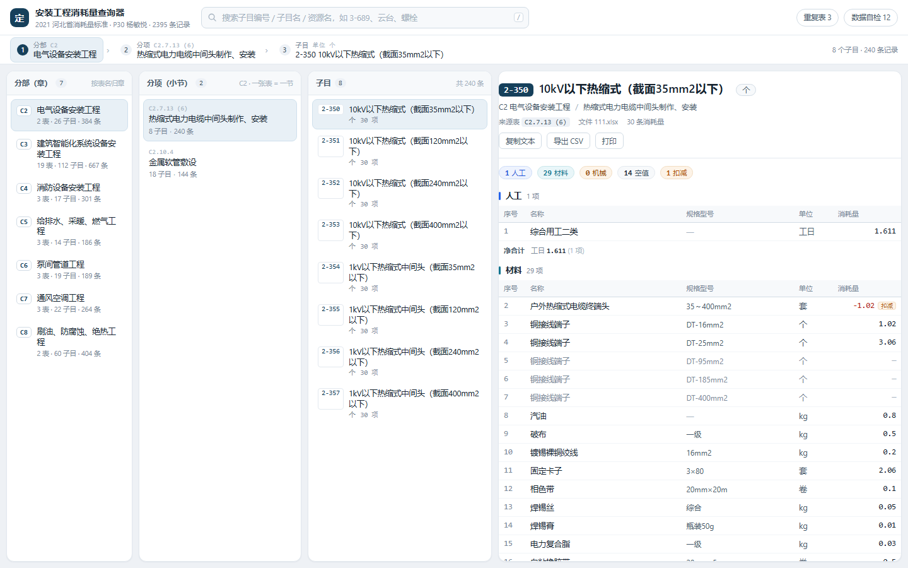
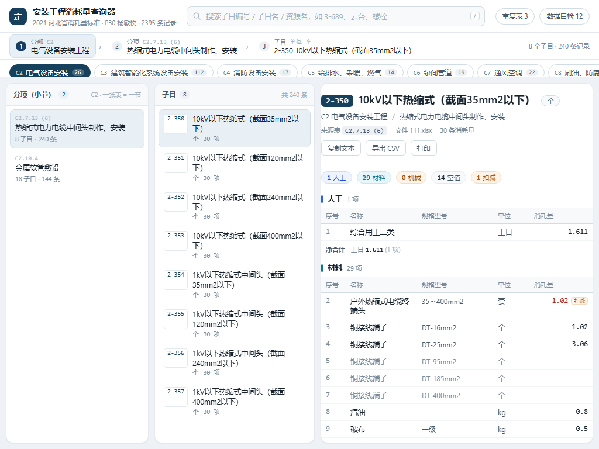

# 安装工程消耗量查询器

> 2021 河北省安装工程消耗量标准 · **分部 → 分项 → 子目 → 人工/材料/机械明细** 四级联动只读查询器
> 单文件、纯离线、无后端；可装进安卓桌面，用起来像一个小程序。

<p>
  
  
  
  
</p>



---

## 1. 这是什么

造价 / 安装工程从业者和学生查定额时，通常要在几百页 Excel 标准里翻表：先找章，再找小节，再对齐编号，最后才看到人工、材料、机械各消耗多少。表格本身还夹着一堆历史遗留问题——表名和内容章号不一致、三张表内容逐格重复、同一个编号在不同工作表里单位不同。

本项目把 2 个源文件、35 张工作表整理成一份结构化的只读数据集，做成一个**打开即用、不联网也能查**的单页应用：

- 左边点分部，中间点分项，右边点子目，明细立刻出来，三栏选中态永远一致；
- 搜索框里打 `3-689` 或「云台」，命中编号 / 子目名 / 资源名三路；
- 地址栏带深链接（`#/d3/s-C3.7.4/i-C3.7.4-3-722`），刷新、分享、收藏都回到同一格；
- 数据里的坑（章号不一致、重复表、同号异义）不藏起来，在界面上直接标出来；
- 单个子目可复制文本、导出 CSV、直接打印。

**适合谁用**：需要频繁查安装定额的造价人员、施工技术员、工程造价/工程管理专业学生；也适合当作「把 Excel 标准做成查询工具」的参考实现。

---

## 2. 功能一览

| 能力 | 说明 |
| --- | --- |
| 四级联动 | 点分部自动落到该章首个分项首个子目；点分项落到首个子目；选中态三栏同步 |
| 明细分组 | 人工 / 材料 / 机械 三组表，按原表 `record_no` 升序，不重排 |
| 特殊值如实呈现 | 空值显示 `—` 且不计入合计；负值原样显示并标「扣减」；`10m`、`100kg` 等单位不换算 |
| 搜索 | 编号 / 子目名 / 资源名；`/` 聚焦、`↑↓` 选择、`Enter` 打开、`Esc` 清空 |
| 深链接 | Hash 路由，复制地址即可定位到具体子目 |
| 数据标记 | 章号不一致、内容重复、表名字段不符、同编号异义，均在界面显式标注 |
| 自检面板 | 12 条构建期校验 + 8 项统计，说明哪些数字不能直接用 |
| 导出 | 复制为文本 / CSV（UTF-8 BOM，Excel 直接打开）/ 打印样式 |
| 响应式 | ≥1320 四栏 · 1024–1319 三栏 · <1024 单栏 + 1/4 步骤式 |
| 离线 / 可安装 | Service Worker 缓存全部资源，安卓 Chrome 可「添加到主屏幕」独立运行 |

| 手机（390px） | 平板（1024px） |
| --- | --- |
|  |  |

---

## 3. 三种用法

### 3.1 直接双击（最快，零环境）

下载仓库，双击 `index.html`。整个应用（含全部数据）都在这一个文件里，不联网、不需要服务器、不装任何东西。

> 单文件模式下没有 Service Worker（`file://` 不支持），也就没有「装到桌面」和离线缓存——但页面本身已经是离线的。

### 3.2 本地起服务（要测 PWA 时用）

```bash
node scripts/serve.mjs        # 或 npm run serve
# 打开 http://127.0.0.1:8123/
```

Service Worker、manifest 都只在 `http(s)` 下生效，验证安装能力请用这个方式，别用双击。

### 3.3 装到安卓手机（推荐，见第 7 节）

部署到 GitHub Pages（仓库自带 workflow）→ 手机 Chrome 打开网址 → 菜单「添加到主屏幕」→ 桌面多一个图标，点开全屏无地址栏、断网可用。

---

## 4. 目录结构

```
install-quota-query/
├─ index.html                  # 应用本体：内联 React 18 + 全量数据，单文件可离线运行
├─ data/
│  └─ dataset.json             # 数据源（544 KB）：divisions / sections / items / consumptions
├─ manifest.webmanifest        # PWA 清单：名称、图标、standalone 显示、启动路径
├─ sw.js                       # Service Worker：导航 network-first，静态资源 cache-first
├─ icons/                      # 192 / 512 / maskable / apple-touch 图标
├─ scripts/
│  ├─ extract-data.mjs         # index.html → data/dataset.json（反向抽取，用于二次编辑）
│  ├─ build.mjs                # data/dataset.json → index.html（写回 + 4 项自检）
│  ├─ serve.mjs                # 零依赖本地静态服务器
│  └─ make-icons.py            # 生成全部图标（Pillow，无需设计稿）
├─ docs/
│  ├─ 01-开发计划与任务目标.md   # 原始项目的目标、数据现状、里程碑
│  ├─ 02-需求说明书.md           # 背景、目标、设计与实现
│  ├─ 03-数据契约与筛选规则.md   # 主键、归章规则、V1–V12 校验、展示规则
│  ├─ 04-验收报告.md             # 对账结果、实测数据、遗留风险
│  ├─ 05-安卓安装与PWA方案.md    # 安卓「像小程序一样打开」的完整方案与配置
│  └─ shots/                    # 界面截图
├─ .github/workflows/pages.yml  # 推 main 自动发布到 GitHub Pages
├─ package.json  .nojekyll  LICENSE  NOTICE
└─ README.md
```

> `docs/01`–`04` 来自原始 Vite 工程（`src/`、`npm run data` 等），保留作设计档案；本仓库发布的是其**构建产物**，因此目录里没有 `src/`，数据以 `data/dataset.json` 为准。

---

## 5. 数据说明

| 指标 | 值 |
| --- | --- |
| 分部（章） | 7（第 1 章无数据，不显示） |
| 分项（小节） | 35（一张工作表 = 一个小节） |
| 子目 | 270（主键 = 工作表名 + 定额编号） |
| 消耗量记录 | 2395（人工 270 / 材料 1773 / 机械 352） |
| 空值 / 负值 | 372（15.5%）/ 136（5.7%） |
| 同号异义编号 | 4 个（如 `2-95`~`2-98` 在不同表里分别按 `10m`、`台` 计） |
| 内容重复表 | 3 张（`C3.8.1（3）（4）（5）` 逐格相同） |
| 表名与内容章号不一致 | 9 张 |

### 5.1 四个必须绕开的坑

1. **`sheet_name` 字段不可信**——`C3.8.1（3）（4）（5）` 三张表都写成 `C3.8.1`，所以分项主键用的是**工作表实名**；
2. **章号看编号不看表名**——9 张表的表名章号与内容不符（如 `C5.9 (5)` 装的是第 2 章电缆头），章号取 `编号.split('-')[0]`；
3. **有 3 张表逐格重复**——用内容哈希识别，默认折叠，顶栏可开关；
4. **同编号不同含义**——子目主键带上工作表名，详情页可互相跳转。

细节见 [docs/03-数据契约与筛选规则.md](docs/03-数据契约与筛选规则.md)。

### 5.2 数据结构

`data/dataset.json` 顶层五个字段：

| 字段 | 说明 |
| --- | --- |
| `meta` | 标题、数据归属、源文件清单、规模统计、12 条校验结果、构建 id |
| `divisions[]` | 分部：`{ id, no, name, sectionIds[], itemCount, recordCount }` |
| `sections[]` | 分项：`{ id, sheetName, title, divisionId, itemIds[], itemCount, recordCount, contentHash, dupOf }` |
| `items[]` | 子目：`{ id, code, name, unit, sectionId, divisionId, consumptionIds[] }` |
| `consumptions[]` | 消耗量：`{ id, itemId, category, name, spec, unit, qty, recordNo, note }`，`category` 为 人工/材料/机械 |

`qty` 保留原表数值：`null` 表示原格为空，负数表示扣减，绝不做补零或取绝对值。

---

## 6. 改数据 / 重新构建

应用是「数据写回单文件」的模型，改完数据需要重新生成 `index.html`：

```bash
# 1) 改数据：直接编辑 data/dataset.json（推荐用编辑器 + JSON 校验）
# 2) 写回单文件并自检
npm run build
#    ✓ meta.counts.* 与数组长度一致
#    ✓ 每个子目的 consumptionIds 都能在 consumptions 里找到
#    任一项不通过会直接中止，不会产出错数据的 index.html

# 3) 本地验收
npm run serve
```

如果你手上是别人给的 `index.html`，想把它还原成可编辑的数据文件：

```bash
npm run extract     # 生成 data/dataset.json，并给 index.html 打上 DATA 标记
```

图标改了配色或文字后重新生成：

```bash
npm run icons       # 需要 Python + Pillow
```

改了 `index.html` / 图标后**记得把 `sw.js` 里的 `VERSION` 加一**，否则老用户会继续命中旧缓存。

---

## 7. 安卓上「像小程序一样」打开

一句话结论：**做成 PWA，用 GitHub Pages 提供 HTTPS，安卓 Chrome 添加到主屏幕即可**——不用上应用商店、不用打包 APK、体积约 1 MB、断网可用、桌面图标点开是全屏独立窗口。

```bash
# 仓库已带 Pages workflow，推上去就自动部署
git push origin main
# 打开 https://<你的用户名>.github.io/install-quota-query/
```

手机端操作（Chrome / Edge）：

1. 打开上面的网址，等首屏渲染出来；
2. 右上角 `⋮` → **添加到主屏幕**（部分版本显示「安装应用」）；
3. 桌面出现「消耗量查询」图标，点开是全屏、无地址栏；飞行模式下也能查。

配置要点（本仓库已就绪）：

| 关键项 | 本仓库取值 | 为什么 |
| --- | --- | --- |
| `display` | `standalone` | 去掉浏览器地址栏，接近原生 |
| `start_url` | `./index.html?source=pwa` | 相对路径，仓库改名 / 放子路径都不坏 |
| `scope` | `./` | 限定在应用目录内导航 |
| `icons` | 192 + 512 + maskable | 满足安卓安装条件；maskable 避免被裁成方块 |
| `theme_color` | `#16405b` | 状态栏与界面主色一致 |
| `sw.js` | 导航 network-first + 资源 cache-first | 更新能拿到，断网能打开 |

完整的方案对比（PWA / TWA 打包 APK / Capacitor / 微信小程序）、逐步配置、验证清单和踩坑排查，见 **[docs/05-安卓安装与PWA方案.md](docs/05-安卓安装与PWA方案.md)**。

> 说明：真正的微信小程序需要重写为 WXML/WXSS 并在微信后台注册，Web 应用无法直接「变成」小程序。想要的是「轻量、点开即用、桌面有图标」，PWA 是成本最低且体验最接近的路径；文档里也给了必须走小程序时的替代做法。

---

## 8. 常见问题

**Q：为什么不做后端 / 数据库？**
数据只有 2395 条且基本不变，构建期内联后 gzip 105 KB。打开即用、离线可用、没有配额和运维成本。需要在线维护数据时再加云数据库即可，接口边界已在 `docs/03` 里划好。

**Q：合计为什么只在同单位内求和？**
子目单位有 `10m`、`100kg`、`个`，资源单位有 `工日`、`套`、`台班`、`%`，跨单位相加会差 10 倍以上，直接得出错误结论。

**Q：空值和负值为什么不补成 0 或取绝对值？**
空值代表原表该格为空，负值代表扣减。补 0 或取绝对值都会失真，所以界面用 `—` 和「扣减」如实呈现。

**Q：双击打开和部署后功能有差别吗？**
只有 PWA 相关能力有差别：`file://` 下没有 Service Worker，因此没有安装入口和缓存。查询功能完全一致。

**Q：`C3.8.1（3）（4）（5）` 点开和 `C3.8.1` 一模一样？**
它们内容确实逐格相同，是源文件里的重复数据。默认折叠，顶栏「重复表 3」可展开对照。

---

## 9. 已知限制

- 数据集覆盖 7 个分部，第 1 章（机械设备安装）在源文件中无有效工作表，界面不显示；
- 源表有 9 张表名章号与内容不符，界面按编号归章并标注，不修正原始数据；
- 单文件模型下代码与数据混在 `index.html`，改动代码需要在构建产物上直接改（无 TS 源码）；
- 未做多语言、未做用户自定义数据导入（可作为后续方向）。

---

## 10. 数据版权与免责

- **代码**以 MIT 协议开源，可自由使用、修改、商用、再分发（保留版权声明）。
- **数据**整理自课程实践提供的 2021 河北省安装工程消耗量标准源表，**著作权归原标准出版方 / 编制单位所有**。本仓库仅为教学与技术演示目的做结构化整理，不构成对标准原文的替代，也不可作为计价、结算、索赔的依据。正式计价请以现行有效版本的正式出版物为准。
- 若你是权利人不希望数据以此方式公开，请提 Issue，我会在 24 小时内移除数据部分（保留代码与空数据结构）。

---

## 11. 参与贡献

欢迎提 Issue 说清「哪个分部/子目数据不对 + 期望值 + 依据」，或直接 PR：

1. Fork → 改 `data/dataset.json`（或 `index.html`）→ `npm run build` 自检通过；
2. 桌面 / 手机各截一张图放进 PR 描述；
3. 若改动影响缓存，把 `sw.js` 的 `VERSION` 加一。

## 12. License

[MIT](LICENSE) © 2026 杨敏悦
